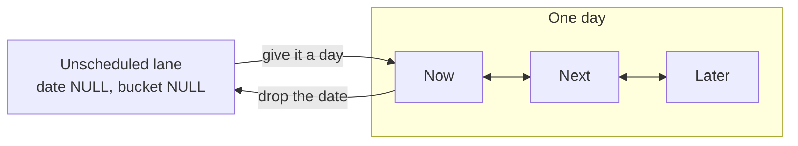

# Step 2: Task data model and API

Status: Done
Depends on: step 1
Blocks: steps 3 to 12

## Read this first

You are working in a pnpm monorepo at `/Users/rraj/Documents/work/tudu`.

- `packages/shared` holds zod schemas and types used by both client and server. Builds
  to `dist/` with `tsc`.
- `packages/db` holds the Drizzle schema and query functions. Neon Postgres over the
  HTTP driver.
- `apps/server` is a Hono API on port 3456, with Better Auth mounted at `/api/auth/*`.
- `packages/store` holds Redux Toolkit and RTK Query.
- `packages/ui` holds all shared React UI. **You do not touch it in this step.**

Read `.cursor/rules/database.mdc`, `.cursor/rules/server-api.mdc` and
`.cursor/rules/redux-store.mdc` before you start. They are short and this plan assumes
them.

### Rules you will break if you are not careful

1. **No em-dash characters (U+2014) anywhere.** `pnpm lint:copy` greps the whole
   working tree and fails the build. This includes markdown, code comments and strings.
2. TypeScript is strict with `noUnusedLocals` and `noUnusedParameters`. An unused import
   fails `pnpm build`.
3. `verbatimModuleSyntax` is on. Type only imports must use `import type { Foo }`.
4. **`packages/db`, `packages/shared` and `apps/server` all use explicit `.js`
   extensions on relative imports.** They emit real ESM that Node runs directly.
   `packages/store` uses `.js` too. Only `packages/ui` omits extensions.
5. Auth is **Better Auth**, not Clerk. Clerk was removed in 0.3.0. Any Clerk reference
   you find in `dist/` is stale build output.
6. **Do not run `pnpm db:generate` until task 4.** The migration history is currently
   broken and task 4 repairs it. Running it early produces a migration that cannot be
   applied. Task 4 explains why.

## Goal

After this step the app has a task engine with no UI. You can create a task in the
backlog over HTTP, schedule it into a day's Now bucket, reorder it against another task,
tick it off, and read both the day and the backlog back. Every row is scoped to the
authenticated user.

Screen wise you will see nothing new. That is expected. This is the spine for steps 3
to 12.

## Non goals

Do not build any of these. They belong to later steps.

- Any UI at all, including the Now cap nudge and the Unscheduled list. Step 3 and 4.
- The rollover job that moves unfinished tasks forward. Step 6.
- `comments`, `timeline_events`, `attachments` tables. Step 5.
- `jiraKey` on a task, or any Atlassian call. Step 10.
- Manager, inbox or permission tables. Step 9.
- Optimistic updates in RTK Query. Step 4. This step uses plain tag invalidation.
- Enforcing the Now soft cap anywhere on the server. See below.

## The model you are implementing

Read the "Product model" section of [README.md](./README.md) first. The three
consequences that shape this step:

**Buckets are within a day.** Now, Next and Later mean committed, queued and first to
slip, for one specific day. They are not a global priority and they are not times of
day.

**A task has a day and a bucket, or neither.** Undated work sits in the Unscheduled
backlog with no bucket. This is enforced by a database check constraint, not by
convention, because Later previously carried two meanings at once and a convention is
what let that happen.

**A lane is one ordered list.** Formally the triple `(userId, scheduledDate, bucket)`,
where both nulls together are the Unscheduled lane. `position` orders a task inside its
lane and means nothing across lanes. Every move in the app is "here are the new
contents of this lane, in order".



### On the Now soft cap

The server never enforces it, and this is deliberate rather than an omission. Step 6's
rollover has to be able to carry five unfinished Now tasks into tomorrow, so an over-cap
day must stay storable. A cap that blocks would also be a different product: the point
is that moving something into Now forces something out, which is a decision the user
makes, not a validation error.

Your only contribution here is exporting `DEFAULT_NOW_SOFT_CAP` from `@tudu/shared`.

---

## Task 1: Install dependencies

The server needs zod and a Hono validator middleware. Nothing else is missing.

```bash
cd /Users/rraj/Documents/work/tudu
pnpm --filter @tudu/server add zod@^4.5.4 @hono/zod-validator@^0.7.0
```

`zod@^4.5.4` is already a dependency of `@tudu/shared`. Match the version so pnpm does
not hoist two copies, which breaks `instanceof` checks inside the validator.

`@hono/zod-validator` must be a version that supports zod 4. If `pnpm add` resolves
something older, check its peer range before continuing.

### Verify

```bash
pnpm install
grep -A5 '"dependencies"' apps/server/package.json
```

Both zod and `@hono/zod-validator` must appear under `apps/server`, not the root.

---

## Task 2: Zod schemas in `packages/shared`

These are the contract. Server and client both import them, so they are the only place
the shape of a task is written down.

### 2a. Create `packages/shared/src/tasks.ts`

```ts
import { z } from "zod";

/** Bucket slots. These are stable ids, not labels: screen C1 lets the user rename
    what gets displayed, and a day that is not today may label them differently.
    See the step 3 open questions in docs/plans/README.md. */
export const BUCKETS = ["now", "next", "later"] as const;

export const bucketSchema = z.enum(BUCKETS);
export type Bucket = z.infer<typeof bucketSchema>;

/** Soft cap on Now. Nudged in the UI, never enforced by the API. Step 11 turns this
    into a preference in the 3 to 5 range. */
export const DEFAULT_NOW_SOFT_CAP = 3;

const isoDateSchema = z
  .string()
  .regex(/^\d{4}-\d{2}-\d{2}$/, "Expected a YYYY-MM-DD date");

/** A task has a day and a bucket, or neither. Nothing in between is valid.
    The database enforces this too, with a check constraint. */
function dayAndBucketPaired(value: {
  scheduledDate: string | null;
  bucket: Bucket | null;
}) {
  return (value.scheduledDate === null) === (value.bucket === null);
}

const PAIRING_MESSAGE =
  "A task needs a day and a bucket together, or neither. Undated tasks belong to the Unscheduled backlog.";

export const subtaskSchema = z.object({
  id: z.uuid(),
  taskId: z.uuid(),
  title: z.string(),
  done: z.boolean(),
  position: z.number().int(),
  createdAt: z.iso.datetime({ offset: true }),
  updatedAt: z.iso.datetime({ offset: true }),
});

export type Subtask = z.infer<typeof subtaskSchema>;

export const taskSchema = z
  .object({
    id: z.uuid(),
    title: z.string(),
    scheduledDate: isoDateSchema.nullable(),
    bucket: bucketSchema.nullable(),
    position: z.number().int(),
    startDate: isoDateSchema.nullable(),
    deadline: z.iso.datetime({ offset: true }).nullable(),
    completedAt: z.iso.datetime({ offset: true }).nullable(),
    carriedDays: z.number().int(),
    carriedSince: isoDateSchema.nullable(),
    isPrivate: z.boolean(),
    createdAt: z.iso.datetime({ offset: true }),
    updatedAt: z.iso.datetime({ offset: true }),
    subtasks: z.array(subtaskSchema),
  })
  .refine(dayAndBucketPaired, { message: PAIRING_MESSAGE, path: ["bucket"] });

export type Task = z.infer<typeof taskSchema>;

export const createTaskRequestSchema = z
  .object({
    title: z.string().trim().min(1, "A task needs a title").max(500),
    scheduledDate: isoDateSchema.nullable().default(null),
    bucket: bucketSchema.nullable().default(null),
    startDate: isoDateSchema.nullable().default(null),
    deadline: z.iso.datetime({ offset: true }).nullable().default(null),
    isPrivate: z.boolean().default(false),
  })
  .refine(dayAndBucketPaired, { message: PAIRING_MESSAGE, path: ["bucket"] });

export type CreateTaskRequest = z.infer<typeof createTaskRequestSchema>;

export const updateTaskRequestSchema = z
  .object({
    title: z.string().trim().min(1).max(500),
    scheduledDate: isoDateSchema.nullable(),
    bucket: bucketSchema.nullable(),
    startDate: isoDateSchema.nullable(),
    deadline: z.iso.datetime({ offset: true }).nullable(),
    /** true stamps completedAt with now, false clears it. */
    completed: z.boolean(),
    isPrivate: z.boolean(),
  })
  .partial()
  .refine((value) => Object.keys(value).length > 0, {
    message: "Nothing to update",
  })
  .refine(
    (value) => {
      const hasDate = "scheduledDate" in value;
      const hasBucket = "bucket" in value;

      if (!hasDate && !hasBucket) {
        return true;
      }

      if (hasDate !== hasBucket) {
        return false;
      }

      return (value.scheduledDate === null) === (value.bucket === null);
    },
    { message: PAIRING_MESSAGE, path: ["bucket"] },
  );

export type UpdateTaskRequest = z.infer<typeof updateTaskRequestSchema>;

/** One lane and its full new contents, in order. */
export const laneSchema = z
  .object({
    scheduledDate: isoDateSchema.nullable(),
    bucket: bucketSchema.nullable(),
    taskIds: z.array(z.uuid()),
  })
  .refine(dayAndBucketPaired, { message: PAIRING_MESSAGE, path: ["bucket"] });

export type Lane = z.infer<typeof laneSchema>;

export const reorderRequestSchema = z.object({
  lanes: z.array(laneSchema).min(1, "Send at least one lane"),
});

export type ReorderRequest = z.infer<typeof reorderRequestSchema>;

export const createSubtaskRequestSchema = z.object({
  title: z.string().trim().min(1, "A subtask needs a title").max(500),
});

export type CreateSubtaskRequest = z.infer<typeof createSubtaskRequestSchema>;

export const updateSubtaskRequestSchema = z
  .object({
    title: z.string().trim().min(1).max(500),
    done: z.boolean(),
  })
  .partial()
  .refine((value) => Object.keys(value).length > 0, {
    message: "Nothing to update",
  });

export type UpdateSubtaskRequest = z.infer<typeof updateSubtaskRequestSchema>;

export type TasksResponse = { tasks: Task[] };
export type TaskResponse = { task: Task };
```

### 2b. Re-export from the barrel

`packages/shared/src/index.ts` currently has no relative imports. Add one, **with the
`.js` extension**, because this package emits ESM that Node loads directly:

```ts
export * from "./tasks.js";
```

Put it at the top of the file, above the existing `HealthResponse` type.

### 2c. Keep tests out of `dist`

`packages/shared/tsconfig.json` has `noEmit: false` and `include: ["src"]`, so the test
file you write in task 8 would be compiled into `dist`. Add to that tsconfig, as a
sibling of `include`:

```json
  "exclude": ["src/**/*.test.ts"]
```

### A note on zod 4

Zod 4 moved string formats to the top level: `z.uuid()` and `z.iso.datetime()` rather
than `z.string().uuid()` and `z.string().datetime()`. The old forms still work but are
deprecated. If any of the above fails to resolve, check the installed zod major before
rewriting anything else.

### Verify

```bash
cd /Users/rraj/Documents/work/tudu
pnpm --filter @tudu/shared build
```

Must exit 0, and `packages/shared/dist/tasks.js` must exist while
`packages/shared/dist/tasks.test.js` must not.

---

## Task 3: Drizzle tables in `packages/db`

### 3a. Create `packages/db/src/tasks-schema.ts`

```ts
import { relations, sql } from "drizzle-orm";
import {
  boolean,
  check,
  date,
  index,
  integer,
  pgEnum,
  pgTable,
  text,
  timestamp,
  uuid,
} from "drizzle-orm/pg-core";
import { user } from "./auth-schema.js";

/** Declaration order matters: Postgres sorts an enum by the order its values were
    declared, so `order by bucket` yields Now, then Next, then Later for free. */
export const taskBucket = pgEnum("task_bucket", ["now", "next", "later"]);

export const tasks = pgTable(
  "tasks",
  {
    id: uuid("id").primaryKey().defaultRandom(),
    userId: text("user_id")
      .notNull()
      .references(() => user.id, { onDelete: "cascade" }),
    title: text("title").notNull(),
    /** Null means unscheduled: the task lives in the backlog, not in any day. */
    scheduledDate: date("scheduled_date", { mode: "string" }),
    /** Null only when scheduledDate is null. No default on purpose: a default would
        silently bucket a backlog task. */
    bucket: taskBucket("bucket"),
    /** Order inside this task's lane. Meaningless across lanes. */
    position: integer("position").notNull(),
    startDate: date("start_date", { mode: "string" }),
    deadline: timestamp("deadline", { withTimezone: true }),
    /** A timestamp rather than a boolean, because step 5's timeline needs to know
        when the task was finished. */
    completedAt: timestamp("completed_at", { withTimezone: true }),
    carriedDays: integer("carried_days").notNull().default(0),
    carriedSince: date("carried_since", { mode: "string" }),
    isPrivate: boolean("is_private").notNull().default(false),
    createdAt: timestamp("created_at", { withTimezone: true })
      .defaultNow()
      .notNull(),
    updatedAt: timestamp("updated_at", { withTimezone: true })
      .defaultNow()
      .$onUpdate(() => new Date())
      .notNull(),
    deletedAt: timestamp("deleted_at", { withTimezone: true }),
  },
  (table) => [
    index("tasks_lane_idx").on(
      table.userId,
      table.scheduledDate,
      table.bucket,
      table.position,
    ),
    /** The whole point of step 2's model decision. A task has a day and a bucket, or
        neither. Postgres indexes and compares nulls fine, so the Unscheduled lane is
        just the lane where both are null. */
    check(
      "tasks_day_and_bucket_paired",
      sql`(${table.scheduledDate} is null) = (${table.bucket} is null)`,
    ),
  ],
);

export const subtasks = pgTable(
  "subtasks",
  {
    id: uuid("id").primaryKey().defaultRandom(),
    taskId: uuid("task_id")
      .notNull()
      .references(() => tasks.id, { onDelete: "cascade" }),
    title: text("title").notNull(),
    done: boolean("done").notNull().default(false),
    position: integer("position").notNull(),
    createdAt: timestamp("created_at", { withTimezone: true })
      .defaultNow()
      .notNull(),
    updatedAt: timestamp("updated_at", { withTimezone: true })
      .defaultNow()
      .$onUpdate(() => new Date())
      .notNull(),
    deletedAt: timestamp("deleted_at", { withTimezone: true }),
  },
  (table) => [index("subtasks_task_idx").on(table.taskId, table.position)],
);

export const tasksRelations = relations(tasks, ({ many, one }) => ({
  subtasks: many(subtasks),
  owner: one(user, {
    fields: [tasks.userId],
    references: [user.id],
  }),
}));

export const subtasksRelations = relations(subtasks, ({ one }) => ({
  task: one(tasks, {
    fields: [subtasks.taskId],
    references: [tasks.id],
  }),
}));

/** Named `TaskRow`, not `Task`, because `@tudu/shared` already exports `Task` as the
    wire shape and `apps/server` imports both in the same file. Row is what is in
    Postgres, Task is what goes over HTTP. */
export type TaskRow = typeof tasks.$inferSelect;
export type NewTaskRow = typeof tasks.$inferInsert;
export type SubtaskRow = typeof subtasks.$inferSelect;
export type NewSubtaskRow = typeof subtasks.$inferInsert;
```

Note there is deliberately **no unique constraint on `position`**. Postgres checks
uniqueness per statement, so the reorder in task 6 writes rows one at a time and would
collide with itself halfway through.

### 3b. Re-export from `packages/db/src/schema.ts`

That file is currently one line. It becomes:

```ts
export * from "./auth-schema.js";
export * from "./tasks-schema.js";
```

Order matters: `tasks-schema.ts` imports `user` from `auth-schema.ts`.

### 3c. Keep tests out of `dist`

Same problem as task 2c. Add to `packages/db/tsconfig.json` as a sibling of `include`:

```json
  "exclude": ["src/**/*.test.ts"]
```

### Verify

```bash
cd /Users/rraj/Documents/work/tudu
pnpm --filter @tudu/db build
```

Must exit 0. Do not run `db:generate` yet.

---

## Task 4: Repair the migration history, then generate the migration

**Read this whole task before running anything.**

### Why this is broken

`packages/db/drizzle/meta/_journal.json` lists two entries, `0000_chief_chronomancer`
and `0001_better_auth`. But `meta/` contains only `0000_snapshot.json`, and that
snapshot describes a single table: `public.users`, the old Clerk table that `0001`
dropped. `0001_better_auth.sql` was written by hand and its snapshot was never created.

Drizzle generates each migration by diffing your schema against the newest snapshot. So
`db:generate` would diff against a world with no Better Auth tables, and emit a
migration that runs `CREATE TABLE "user"` and friends alongside `tasks`. Applying it
fails, because those tables already exist in the database.

Verify the situation for yourself before changing anything:

```bash
cd /Users/rraj/Documents/work/tudu/packages/db
ls drizzle/meta/
node -e "console.log(Object.keys(require('./drizzle/meta/0000_snapshot.json').tables))"
```

You should see only `0000_snapshot.json`, and only `[ 'public.users' ]`.

### The decision already taken

Squash to a single clean baseline and reset the dev database. The database holds nothing
but test accounts at this stage, and the alternative leaves every later step tripping
over the same wall. **You will lose your test users and have to sign up again.**

If the database turns out to hold anything you care about, stop and ask rather than
improvising a repair.

### 4a. Delete the old history

```bash
cd /Users/rraj/Documents/work/tudu/packages/db
rm -rf drizzle
```

### 4b. Generate the baseline

Tasks and subtasks are already in the schema from task 3, so this one baseline covers
the Better Auth tables, `tasks`, `subtasks`, the `task_bucket` enum and the check
constraint together.

```bash
cd /Users/rraj/Documents/work/tudu
pnpm db:generate
```

Read the generated `packages/db/drizzle/0000_*.sql` before going further. It must
contain `CREATE TYPE "public"."task_bucket"`, `CREATE TABLE "user"`,
`CREATE TABLE "tasks"`, `CREATE TABLE "subtasks"` and the
`tasks_day_and_bucket_paired` check. If the check constraint is missing, your `check()`
call in task 3a is wrong. Never hand edit the file to add it.

### 4c. Reset the database and apply

Drizzle tracks applied migrations in its own `drizzle` schema, so that has to go too or
`db:migrate` will think the baseline is already applied.

```bash
cd /Users/rraj/Documents/work/tudu/packages/db
node --input-type=module -e "
import { config } from 'dotenv';
import { neon } from '@neondatabase/serverless';
config({ path: '../../.env' });
const sql = neon(process.env.DATABASE_URL);
await sql\`drop schema if exists drizzle cascade\`;
await sql\`drop schema if exists public cascade\`;
await sql\`create schema public\`;
console.log('schemas reset');
"
```

Then apply the baseline:

```bash
cd /Users/rraj/Documents/work/tudu
pnpm db:migrate
```

### Verify

```bash
cd /Users/rraj/Documents/work/tudu/packages/db
node --input-type=module -e "
import { config } from 'dotenv';
import { neon } from '@neondatabase/serverless';
config({ path: '../../.env' });
const sql = neon(process.env.DATABASE_URL);
const tables = await sql\`select table_name from information_schema.tables where table_schema = 'public' order by table_name\`;
console.log(tables.map((row) => row.table_name));
const checks = await sql\`select conname from pg_constraint where conname = 'tasks_day_and_bucket_paired'\`;
console.log(checks);
"
```

You must see `account`, `session`, `subtasks`, `tasks`, `user`, `verification`, and the
check constraint must come back as one row.

Then prove the constraint actually bites. This insert must be **rejected**:

```bash
node --input-type=module -e "
import { config } from 'dotenv';
import { neon } from '@neondatabase/serverless';
config({ path: '../../.env' });
const sql = neon(process.env.DATABASE_URL);
try {
  await sql\`insert into tasks (user_id, title, scheduled_date, position) values ('nobody', 'should fail', '2026-09-05', 0)\`;
  console.error('FAIL: the constraint did not fire');
} catch (error) {
  console.log('rejected as expected:', error.message);
}
"
```

It should fail. It may fail on the foreign key rather than the check depending on which
Postgres validates first; either rejection proves nothing invalid got in, but to test
the check specifically use a real user id after you have signed up again.

Finally, `meta/` must now contain exactly `0000_snapshot.json` and `_journal.json`, with
one journal entry. History matches reality again.

---

## Task 5: Query functions in `packages/db`

### 5a. Create `packages/db/src/tasks.ts`

The lane arithmetic is a pure function so task 8 can test it without a database.

```ts
import { and, asc, eq, inArray, isNull, sql } from "drizzle-orm";
import type { Bucket, Lane } from "@tudu/shared";
import type { Db } from "./index.js";
import { subtasks, tasks, type SubtaskRow, type TaskRow } from "./tasks-schema.js";

export type TaskRowWithSubtasks = TaskRow & { subtasks: SubtaskRow[] };

export type TaskPlacement = {
  taskId: string;
  scheduledDate: string | null;
  bucket: Bucket | null;
  position: number;
};

/** Flattens lanes into one placement per task. Pure, so it is unit tested directly.
    Positions are contiguous from zero inside each lane. */
export function planReorder(lanes: Lane[]): TaskPlacement[] {
  const placements: TaskPlacement[] = [];
  const seen = new Set<string>();

  for (const lane of lanes) {
    lane.taskIds.forEach((taskId, index) => {
      if (seen.has(taskId)) {
        throw new Error(`Task ${taskId} appears in more than one lane`);
      }

      seen.add(taskId);

      placements.push({
        taskId,
        scheduledDate: lane.scheduledDate,
        bucket: lane.bucket,
        position: index,
      });
    });
  }

  return placements;
}

function laneFilter(
  userId: string,
  scheduledDate: string | null,
  bucket: Bucket | null,
) {
  return and(
    eq(tasks.userId, userId),
    isNull(tasks.deletedAt),
    scheduledDate === null
      ? isNull(tasks.scheduledDate)
      : eq(tasks.scheduledDate, scheduledDate),
    bucket === null ? isNull(tasks.bucket) : eq(tasks.bucket, bucket),
  );
}

const liveSubtasks = {
  subtasks: {
    where: isNull(subtasks.deletedAt),
    orderBy: [asc(subtasks.position)],
  },
} as const;

export async function listTasksForDay(
  db: Db,
  userId: string,
  scheduledDate: string,
): Promise<TaskRowWithSubtasks[]> {
  return db.query.tasks.findMany({
    where: and(
      eq(tasks.userId, userId),
      isNull(tasks.deletedAt),
      eq(tasks.scheduledDate, scheduledDate),
    ),
    with: liveSubtasks,
    // Enum sorts in declaration order, so this is Now, Next, Later.
    orderBy: [asc(tasks.bucket), asc(tasks.position)],
  });
}

export async function listUnscheduledTasks(
  db: Db,
  userId: string,
): Promise<TaskRowWithSubtasks[]> {
  return db.query.tasks.findMany({
    where: and(
      eq(tasks.userId, userId),
      isNull(tasks.deletedAt),
      isNull(tasks.scheduledDate),
    ),
    with: liveSubtasks,
    orderBy: [asc(tasks.position)],
  });
}

export async function findTaskById(
  db: Db,
  userId: string,
  taskId: string,
): Promise<TaskRowWithSubtasks | undefined> {
  return db.query.tasks.findFirst({
    where: and(
      eq(tasks.id, taskId),
      eq(tasks.userId, userId),
      isNull(tasks.deletedAt),
    ),
    with: liveSubtasks,
  });
}

/** Next free position at the bottom of a lane. The design appends: a typed task and an
    accepted task both land at the bottom of their bucket. */
async function nextPosition(
  db: Db,
  userId: string,
  scheduledDate: string | null,
  bucket: Bucket | null,
): Promise<number> {
  const rows = await db
    .select({ highest: sql<number | null>`max(${tasks.position})` })
    .from(tasks)
    .where(laneFilter(userId, scheduledDate, bucket));

  return (rows[0]?.highest ?? -1) + 1;
}

export type CreateTaskInput = {
  userId: string;
  title: string;
  scheduledDate: string | null;
  bucket: Bucket | null;
  startDate: string | null;
  deadline: Date | null;
  isPrivate: boolean;
};

export async function createTask(
  db: Db,
  input: CreateTaskInput,
): Promise<TaskRow> {
  const position = await nextPosition(
    db,
    input.userId,
    input.scheduledDate,
    input.bucket,
  );

  const rows = await db.insert(tasks).values({ ...input, position }).returning();

  return rows[0]!;
}

export type UpdateTaskFields = Partial<
  Pick<
    NewTaskFields,
    | "title"
    | "scheduledDate"
    | "bucket"
    | "startDate"
    | "deadline"
    | "completedAt"
    | "isPrivate"
  >
>;

type NewTaskFields = {
  title: string;
  scheduledDate: string | null;
  bucket: Bucket | null;
  startDate: string | null;
  deadline: Date | null;
  completedAt: Date | null;
  isPrivate: boolean;
};

export async function updateTask(
  db: Db,
  userId: string,
  taskId: string,
  fields: UpdateTaskFields,
): Promise<TaskRow | undefined> {
  const patch: UpdateTaskFields & { position?: number } = { ...fields };

  // Moving a task into a different lane sends it to the bottom of that lane.
  if ("scheduledDate" in fields || "bucket" in fields) {
    patch.position = await nextPosition(
      db,
      userId,
      fields.scheduledDate ?? null,
      fields.bucket ?? null,
    );
  }

  const rows = await db
    .update(tasks)
    .set(patch)
    .where(
      and(
        eq(tasks.id, taskId),
        eq(tasks.userId, userId),
        isNull(tasks.deletedAt),
      ),
    )
    .returning();

  return rows[0];
}

export async function softDeleteTask(
  db: Db,
  userId: string,
  taskId: string,
): Promise<boolean> {
  const rows = await db
    .update(tasks)
    .set({ deletedAt: new Date() })
    .where(
      and(
        eq(tasks.id, taskId),
        eq(tasks.userId, userId),
        isNull(tasks.deletedAt),
      ),
    )
    .returning({ id: tasks.id });

  return rows.length > 0;
}

/** Rewrites bucket, date and position for every task in every lane given.
    Returns false if any id is not a live task owned by this user, in which case
    nothing is written. */
export async function reorderTasks(
  db: Db,
  userId: string,
  lanes: Lane[],
): Promise<boolean> {
  const placements = planReorder(lanes);

  if (placements.length === 0) {
    return true;
  }

  const ids = placements.map((placement) => placement.taskId);

  const owned = await db
    .select({ id: tasks.id })
    .from(tasks)
    .where(
      and(
        eq(tasks.userId, userId),
        isNull(tasks.deletedAt),
        inArray(tasks.id, ids),
      ),
    );

  if (owned.length !== ids.length) {
    return false;
  }

  const writes = placements.map((placement) =>
    db
      .update(tasks)
      .set({
        scheduledDate: placement.scheduledDate,
        bucket: placement.bucket,
        position: placement.position,
      })
      .where(and(eq(tasks.id, placement.taskId), eq(tasks.userId, userId))),
  );

  // Neon over HTTP has no interactive transactions, so `db.batch` is the substitute.
  // Destructuring satisfies its non-empty tuple type without a cast.
  const [first, ...rest] = writes;

  if (first) {
    await db.batch([first, ...rest]);
  }

  return true;
}

export async function createSubtask(
  db: Db,
  taskId: string,
  title: string,
): Promise<SubtaskRow> {
  const rows = await db
    .select({ highest: sql<number | null>`max(${subtasks.position})` })
    .from(subtasks)
    .where(and(eq(subtasks.taskId, taskId), isNull(subtasks.deletedAt)));

  const position = (rows[0]?.highest ?? -1) + 1;

  const inserted = await db
    .insert(subtasks)
    .values({ taskId, title, position })
    .returning();

  return inserted[0]!;
}

/** Scoped through the parent task so a caller cannot touch someone else's subtask. */
export async function updateSubtask(
  db: Db,
  userId: string,
  subtaskId: string,
  fields: Partial<{ title: string; done: boolean }>,
): Promise<SubtaskRow | undefined> {
  const owned = await ownedSubtask(db, userId, subtaskId);

  if (!owned) {
    return undefined;
  }

  const rows = await db
    .update(subtasks)
    .set(fields)
    .where(eq(subtasks.id, subtaskId))
    .returning();

  return rows[0];
}

export async function softDeleteSubtask(
  db: Db,
  userId: string,
  subtaskId: string,
): Promise<boolean> {
  const owned = await ownedSubtask(db, userId, subtaskId);

  if (!owned) {
    return false;
  }

  await db
    .update(subtasks)
    .set({ deletedAt: new Date() })
    .where(eq(subtasks.id, subtaskId));

  return true;
}

async function ownedSubtask(db: Db, userId: string, subtaskId: string) {
  const rows = await db
    .select({ id: subtasks.id })
    .from(subtasks)
    .innerJoin(tasks, eq(subtasks.taskId, tasks.id))
    .where(
      and(
        eq(subtasks.id, subtaskId),
        isNull(subtasks.deletedAt),
        eq(tasks.userId, userId),
        isNull(tasks.deletedAt),
      ),
    )
    .limit(1);

  return rows[0];
}
```

### 5b. Re-export from `packages/db/src/index.ts`

Add below the existing `export * from "./schema.js";`:

```ts
export * from "./tasks.js";
```

### Verify

```bash
cd /Users/rraj/Documents/work/tudu
pnpm --filter @tudu/db build
```

Must exit 0. If `db.query.tasks` does not typecheck, `tasksRelations` is missing from
the schema barrel: relational queries need the relations exported, not just the tables.

---

## Task 6: Server routes

### 6a. Create `apps/server/src/routes/tasks.ts`

```ts
import { zValidator } from "@hono/zod-validator";
import type {
  Db,
  SubtaskRow,
  TaskRowWithSubtasks,
  UpdateTaskFields,
} from "@tudu/db";
import {
  createSubtask,
  createTask,
  findTaskById,
  listTasksForDay,
  listUnscheduledTasks,
  reorderTasks,
  softDeleteSubtask,
  softDeleteTask,
  updateSubtask,
  updateTask,
} from "@tudu/db";
import {
  createSubtaskRequestSchema,
  createTaskRequestSchema,
  reorderRequestSchema,
  updateSubtaskRequestSchema,
  updateTaskRequestSchema,
  type Subtask,
  type Task,
  type TaskResponse,
  type TasksResponse,
  type UpdateTaskRequest,
} from "@tudu/shared";
import { Hono } from "hono";
import type { Context } from "hono";
import { z } from "zod";
import type { SessionEnv } from "../session-middleware.js";

/** zValidator's default 400 body does not match the repo's `{ error }` convention,
    so every use goes through these two wrappers. */
function jsonBody<T extends z.ZodType>(schema: T) {
  return zValidator("json", schema, (result, c) => {
    if (!result.success) {
      const message = result.error.issues[0]?.message ?? "Invalid request body";
      return c.json({ error: message }, 400);
    }
  });
}

function queryParams<T extends z.ZodType>(schema: T) {
  return zValidator("query", schema, (result, c) => {
    if (!result.success) {
      const message = result.error.issues[0]?.message ?? "Invalid query";
      return c.json({ error: message }, 400);
    }
  });
}

const dayQuerySchema = z.object({
  date: z.string().regex(/^\d{4}-\d{2}-\d{2}$/, "Expected a YYYY-MM-DD date"),
});

function toSubtask(row: SubtaskRow): Subtask {
  return {
    id: row.id,
    taskId: row.taskId,
    title: row.title,
    done: row.done,
    position: row.position,
    createdAt: row.createdAt.toISOString(),
    updatedAt: row.updatedAt.toISOString(),
  };
}

function toTask(row: TaskRowWithSubtasks): Task {
  return {
    id: row.id,
    title: row.title,
    scheduledDate: row.scheduledDate,
    bucket: row.bucket,
    position: row.position,
    startDate: row.startDate,
    deadline: row.deadline?.toISOString() ?? null,
    completedAt: row.completedAt?.toISOString() ?? null,
    carriedDays: row.carriedDays,
    carriedSince: row.carriedSince,
    isPrivate: row.isPrivate,
    createdAt: row.createdAt.toISOString(),
    updatedAt: row.updatedAt.toISOString(),
    subtasks: row.subtasks.map(toSubtask),
  };
}

/** Translates the wire patch into database fields. `completed` is a boolean on the
    wire and a nullable timestamp in the database. The return type must be
    `UpdateTaskFields` and not `Record<string, unknown>`, or `updateTask` will not
    accept it. */
function toUpdateFields(patch: UpdateTaskRequest): UpdateTaskFields {
  const fields: UpdateTaskFields = {};

  if ("title" in patch) fields.title = patch.title;
  if ("scheduledDate" in patch) fields.scheduledDate = patch.scheduledDate;
  if ("bucket" in patch) fields.bucket = patch.bucket;
  if ("startDate" in patch) fields.startDate = patch.startDate;
  if ("isPrivate" in patch) fields.isPrivate = patch.isPrivate;

  if ("deadline" in patch) {
    fields.deadline = patch.deadline ? new Date(patch.deadline) : null;
  }

  if ("completed" in patch) {
    fields.completedAt = patch.completed ? new Date() : null;
  }

  return fields;
}

export function createTasksRoute(db: Db) {
  const app = new Hono<SessionEnv>();

  /** Every route below is authenticated. Scoping is by session, never by a body id. */
  app.use("*", async (c, next) => {
    const session = c.get("session");

    if (!session?.user) {
      return c.json({ error: "Unauthorized" }, 401);
    }

    await next();
  });

  /** Safe after the middleware above, which already returned 401 if there is no
      session. Do not reach for a hand rolled context type here: use the assertion. */
  function userId(c: Context<SessionEnv>) {
    return c.get("session")!.user.id;
  }

  // Literal segments must be registered before their /:id equivalents, or Hono
  // matches "unscheduled" and "reorder" as task ids.
  app.get("/tasks/unscheduled", async (c) => {
    const rows = await listUnscheduledTasks(db, userId(c));
    const response: TasksResponse = { tasks: rows.map(toTask) };

    return c.json(response);
  });

  app.patch("/tasks/reorder", jsonBody(reorderRequestSchema), async (c) => {
    const { lanes } = c.req.valid("json");
    const ok = await reorderTasks(db, userId(c), lanes);

    if (!ok) {
      return c.json({ error: "One or more tasks were not found" }, 404);
    }

    return c.body(null, 204);
  });

  app.get("/tasks", queryParams(dayQuerySchema), async (c) => {
    const { date } = c.req.valid("query");
    const rows = await listTasksForDay(db, userId(c), date);
    const response: TasksResponse = { tasks: rows.map(toTask) };

    return c.json(response);
  });

  app.post("/tasks", jsonBody(createTaskRequestSchema), async (c) => {
    const body = c.req.valid("json");

    const created = await createTask(db, {
      userId: userId(c),
      title: body.title,
      scheduledDate: body.scheduledDate,
      bucket: body.bucket,
      startDate: body.startDate,
      deadline: body.deadline ? new Date(body.deadline) : null,
      isPrivate: body.isPrivate,
    });

    const row = await findTaskById(db, userId(c), created.id);

    if (!row) {
      return c.json({ error: "Task not found after create" }, 500);
    }

    const response: TaskResponse = { task: toTask(row) };

    return c.json(response, 201);
  });

  app.patch("/tasks/:id", jsonBody(updateTaskRequestSchema), async (c) => {
    const updated = await updateTask(
      db,
      userId(c),
      c.req.param("id"),
      toUpdateFields(c.req.valid("json")),
    );

    if (!updated) {
      return c.json({ error: "Task not found" }, 404);
    }

    const row = await findTaskById(db, userId(c), updated.id);

    if (!row) {
      return c.json({ error: "Task not found" }, 404);
    }

    const response: TaskResponse = { task: toTask(row) };

    return c.json(response);
  });

  app.delete("/tasks/:id", async (c) => {
    const deleted = await softDeleteTask(db, userId(c), c.req.param("id"));

    if (!deleted) {
      return c.json({ error: "Task not found" }, 404);
    }

    return c.body(null, 204);
  });

  app.post(
    "/tasks/:id/subtasks",
    jsonBody(createSubtaskRequestSchema),
    async (c) => {
      const taskId = c.req.param("id");
      const parent = await findTaskById(db, userId(c), taskId);

      if (!parent) {
        return c.json({ error: "Task not found" }, 404);
      }

      await createSubtask(db, taskId, c.req.valid("json").title);

      const row = await findTaskById(db, userId(c), taskId);
      const response: TaskResponse = { task: toTask(row!) };

      return c.json(response, 201);
    },
  );

  app.patch(
    "/subtasks/:id",
    jsonBody(updateSubtaskRequestSchema),
    async (c) => {
      const updated = await updateSubtask(
        db,
        userId(c),
        c.req.param("id"),
        c.req.valid("json"),
      );

      if (!updated) {
        return c.json({ error: "Subtask not found" }, 404);
      }

      const row = await findTaskById(db, userId(c), updated.taskId);
      const response: TaskResponse = { task: toTask(row!) };

      return c.json(response);
    },
  );

  app.delete("/subtasks/:id", async (c) => {
    const deleted = await softDeleteSubtask(db, userId(c), c.req.param("id"));

    if (!deleted) {
      return c.json({ error: "Subtask not found" }, 404);
    }

    return c.body(null, 204);
  });

  return app;
}
```

### 6b. Mount it in `apps/server/src/index.ts`

Add the import at the top, next to the other local imports:

```ts
import { createTasksRoute } from "./routes/tasks.js";
```

Then, **below** the `app.use("*", createSessionMiddleware(auth))` block and next to the
existing `/me` route, add:

```ts
if (db) {
  app.route("/", createTasksRoute(db));
}
```

The `if (db)` guard mirrors how `auth` is already guarded: the server has to boot
without `DATABASE_URL` so `/health` keeps answering.

### Verify

```bash
cd /Users/rraj/Documents/work/tudu
pnpm --filter @tudu/server build
```

Must exit 0. If `zValidator`'s generic fights you, inline the error hook at each call
site rather than fighting the wrapper: matching the `{ error }` shape matters, the
wrapper does not.

---

## Task 7: RTK Query endpoints in `packages/store`

### 7a. Add the tag

In `packages/store/src/api/baseApi.ts`, change:

```ts
  tagTypes: ["Health", "Me"],
```

to:

```ts
  tagTypes: ["Health", "Me", "Task"],
```

### 7b. Create `packages/store/src/api/tasksApi.ts`

```ts
import type {
  CreateSubtaskRequest,
  CreateTaskRequest,
  ReorderRequest,
  TaskResponse,
  TasksResponse,
  UpdateSubtaskRequest,
  UpdateTaskRequest,
} from "@tudu/shared";
import { baseApi } from "./baseApi.js";

/** A single drag can move a task between a day and the backlog, so every mutation
    invalidates the whole Task tag rather than trying to be surgical. Step 4 replaces
    this with optimistic updates. */
export const tasksApi = baseApi.injectEndpoints({
  endpoints: (builder) => ({
    getTasksForDay: builder.query<TasksResponse, string>({
      query: (date) => ({ url: "/tasks", params: { date } }),
      providesTags: ["Task"],
    }),
    getUnscheduledTasks: builder.query<TasksResponse, void>({
      query: () => "/tasks/unscheduled",
      providesTags: ["Task"],
    }),
    createTask: builder.mutation<TaskResponse, CreateTaskRequest>({
      query: (body) => ({ url: "/tasks", method: "POST", body }),
      invalidatesTags: ["Task"],
    }),
    updateTask: builder.mutation<
      TaskResponse,
      { id: string; patch: UpdateTaskRequest }
    >({
      query: ({ id, patch }) => ({
        url: `/tasks/${id}`,
        method: "PATCH",
        body: patch,
      }),
      invalidatesTags: ["Task"],
    }),
    deleteTask: builder.mutation<void, string>({
      query: (id) => ({ url: `/tasks/${id}`, method: "DELETE" }),
      invalidatesTags: ["Task"],
    }),
    reorderTasks: builder.mutation<void, ReorderRequest>({
      query: (body) => ({ url: "/tasks/reorder", method: "PATCH", body }),
      invalidatesTags: ["Task"],
    }),
    createSubtask: builder.mutation<
      TaskResponse,
      { taskId: string; body: CreateSubtaskRequest }
    >({
      query: ({ taskId, body }) => ({
        url: `/tasks/${taskId}/subtasks`,
        method: "POST",
        body,
      }),
      invalidatesTags: ["Task"],
    }),
    updateSubtask: builder.mutation<
      TaskResponse,
      { id: string; patch: UpdateSubtaskRequest }
    >({
      query: ({ id, patch }) => ({
        url: `/subtasks/${id}`,
        method: "PATCH",
        body: patch,
      }),
      invalidatesTags: ["Task"],
    }),
    deleteSubtask: builder.mutation<void, string>({
      query: (id) => ({ url: `/subtasks/${id}`, method: "DELETE" }),
      invalidatesTags: ["Task"],
    }),
  }),
});

export const {
  useGetTasksForDayQuery,
  useGetUnscheduledTasksQuery,
  useCreateTaskMutation,
  useUpdateTaskMutation,
  useDeleteTaskMutation,
  useReorderTasksMutation,
  useCreateSubtaskMutation,
  useUpdateSubtaskMutation,
  useDeleteSubtaskMutation,
} = tasksApi;
```

### 7c. Export from the barrel

Add to `packages/store/src/index.ts`, keeping the `.js` extension convention:

```ts
export {
  tasksApi,
  useGetTasksForDayQuery,
  useGetUnscheduledTasksQuery,
  useCreateTaskMutation,
  useUpdateTaskMutation,
  useDeleteTaskMutation,
  useReorderTasksMutation,
  useCreateSubtaskMutation,
  useUpdateSubtaskMutation,
  useDeleteSubtaskMutation,
} from "./api/tasksApi.js";
```

Nothing imports these yet. That is fine and expected: `packages/store` has `noEmit`, so
an unused export is not a build failure the way an unused local would be.

### Verify

```bash
cd /Users/rraj/Documents/work/tudu
pnpm --filter @tudu/store exec tsc --noEmit
```

---

## Task 8: Tests

Two files. The root `vitest.config.ts` only collects `packages/**/*.test.{ts,tsx}`, so
no config change is needed and neither test touches a database.

### 8a. `packages/shared/src/tasks.test.ts`

This is the guard on the model decision, so it is the more important of the two.

```ts
import { describe, expect, it } from "vitest";
import { createTaskRequestSchema, laneSchema } from "./tasks.js";

describe("createTaskRequestSchema", () => {
  it("rejects a blank title", () => {
    const result = createTaskRequestSchema.safeParse({ title: "   " });

    expect(result.success).toBe(false);
  });

  it("defaults an otherwise bare task into the unscheduled backlog", () => {
    const result = createTaskRequestSchema.parse({ title: "Write the runbook" });

    expect(result.scheduledDate).toBeNull();
    expect(result.bucket).toBeNull();
  });

  it("rejects a day without a bucket", () => {
    const result = createTaskRequestSchema.safeParse({
      title: "Write the runbook",
      scheduledDate: "2026-09-05",
    });

    expect(result.success).toBe(false);
  });

  it("rejects a bucket without a day", () => {
    const result = createTaskRequestSchema.safeParse({
      title: "Write the runbook",
      bucket: "now",
    });

    expect(result.success).toBe(false);
  });

  it("accepts a day and a bucket together", () => {
    const result = createTaskRequestSchema.safeParse({
      title: "Write the runbook",
      scheduledDate: "2026-09-05",
      bucket: "now",
    });

    expect(result.success).toBe(true);
  });

  it("rejects a malformed date", () => {
    const result = createTaskRequestSchema.safeParse({
      title: "Write the runbook",
      scheduledDate: "5 Sep 2026",
      bucket: "now",
    });

    expect(result.success).toBe(false);
  });
});

describe("laneSchema", () => {
  it("accepts the unscheduled lane", () => {
    const result = laneSchema.safeParse({
      scheduledDate: null,
      bucket: null,
      taskIds: [],
    });

    expect(result.success).toBe(true);
  });

  it("rejects a lane with a bucket but no day", () => {
    const result = laneSchema.safeParse({
      scheduledDate: null,
      bucket: "later",
      taskIds: [],
    });

    expect(result.success).toBe(false);
  });
});
```

### 8b. `packages/db/src/tasks.test.ts`

```ts
import { describe, expect, it } from "vitest";
import { planReorder } from "./tasks.js";

describe("planReorder", () => {
  it("numbers a lane contiguously from zero", () => {
    const placements = planReorder([
      { scheduledDate: "2026-09-05", bucket: "now", taskIds: ["a", "b", "c"] },
    ]);

    expect(placements.map((placement) => placement.position)).toEqual([0, 1, 2]);
  });

  it("moves a task across buckets on the same day", () => {
    const placements = planReorder([
      { scheduledDate: "2026-09-05", bucket: "now", taskIds: ["a"] },
      { scheduledDate: "2026-09-05", bucket: "next", taskIds: ["b", "c"] },
    ]);

    expect(placements).toEqual([
      { taskId: "a", scheduledDate: "2026-09-05", bucket: "now", position: 0 },
      { taskId: "b", scheduledDate: "2026-09-05", bucket: "next", position: 0 },
      { taskId: "c", scheduledDate: "2026-09-05", bucket: "next", position: 1 },
    ]);
  });

  it("schedules a task out of the backlog into a day", () => {
    const placements = planReorder([
      { scheduledDate: null, bucket: null, taskIds: ["b"] },
      { scheduledDate: "2026-09-05", bucket: "now", taskIds: ["a"] },
    ]);

    expect(placements[0]).toEqual({
      taskId: "b",
      scheduledDate: null,
      bucket: null,
      position: 0,
    });
    expect(placements[1]?.bucket).toBe("now");
  });

  it("refuses the same task in two lanes", () => {
    expect(() =>
      planReorder([
        { scheduledDate: "2026-09-05", bucket: "now", taskIds: ["a"] },
        { scheduledDate: "2026-09-05", bucket: "next", taskIds: ["a"] },
      ]),
    ).toThrow();
  });
});
```

`packages/db/src/tasks.ts` imports `Db` with `import type`, so pulling it into a test
does not open a database connection. Keep it that way.

### 8c. On the missing server tests

There are none, on purpose. The route handlers need a live Neon database and there is no
test harness for that in the repo. Adding one is worth a step of its own. Do not
substitute mocks of the Drizzle query builder: they would assert the shape of the
library rather than the behaviour of the code.

The `curl` walkthrough in the verification section below is the manual stand in.

### Verify

```bash
cd /Users/rraj/Documents/work/tudu
pnpm test
```

All tests green, including step 1's two.

---

## Task 9: Update the roadmap

Edit `docs/plans/README.md` and change the step 2 row status from `Pending` to `Done`.

---

## Verification checklist

Run all of these from `/Users/rraj/Documents/work/tudu`. Every one must pass.

```bash
pnpm install
pnpm lint:copy          # must print "No em-dashes found."
pnpm build
pnpm test
```

Then exercise the API by hand. Start the server, and sign up again, since task 4 reset
the database:

```bash
pnpm dev:server
```

In a second terminal, sign up and keep the cookie jar:

```bash
curl -s -c /tmp/tudu.jar -X POST http://localhost:3456/api/auth/sign-up/email \
  -H 'Content-Type: application/json' \
  -d '{"email":"you@example.com","password":"averylongpassword","name":"You"}'

curl -s -b /tmp/tudu.jar http://localhost:3456/me
```

Then walk a task through the whole lane model:

```bash
# 1. Create a task in the backlog. No date, no bucket.
curl -s -b /tmp/tudu.jar -X POST http://localhost:3456/tasks \
  -H 'Content-Type: application/json' \
  -d '{"title":"Draft DR runbook"}'

# 2. It shows up in the backlog, and not in today.
curl -s -b /tmp/tudu.jar http://localhost:3456/tasks/unscheduled
curl -s -b /tmp/tudu.jar 'http://localhost:3456/tasks?date=2026-09-05'

# 3. A day without a bucket must be rejected with 400 and an { error } body.
curl -s -o /dev/null -w '%{http_code}\n' -b /tmp/tudu.jar -X POST http://localhost:3456/tasks \
  -H 'Content-Type: application/json' \
  -d '{"title":"Invalid","scheduledDate":"2026-09-05"}'

# 4. Create a second task straight into Now, then reorder the pair.
#    Substitute the real ids from the responses above.
curl -s -b /tmp/tudu.jar -X PATCH http://localhost:3456/tasks/reorder \
  -H 'Content-Type: application/json' \
  -d '{"lanes":[{"scheduledDate":"2026-09-05","bucket":"now","taskIds":["ID_B","ID_A"]}]}'

# 5. Read the day back. Positions are 0 and 1, in the order you sent.
curl -s -b /tmp/tudu.jar 'http://localhost:3456/tasks?date=2026-09-05'

# 6. The scheduled task is gone from the backlog.
curl -s -b /tmp/tudu.jar http://localhost:3456/tasks/unscheduled
```

Check by eye:

1. Step 3 returns `400` with a body shaped `{"error":"..."}`, not zod's default shape.
2. Step 5 returns both tasks in the order you sent, `position` 0 then 1.
3. Every timestamp in every response is an ISO string, never a raw object.
4. Hitting any `/tasks` route with no cookie returns `401` and `{"error":"Unauthorized"}`.
5. Signing up a second account and requesting `/tasks?date=...` returns an empty list.
   Nothing leaks across users.

## Things most likely to go wrong

- **`db:generate` before task 4.** The single biggest trap in this step. The migration
  history is missing `0001`'s snapshot, so an early generate emits `CREATE TABLE "user"`
  and the migration cannot apply. If you have already done it, delete the generated
  files and start task 4 from the top.
- **Two copies of zod.** `@tudu/shared` and `apps/server` must resolve the same zod.
  If `@hono/zod-validator` reports a schema as invalid that clearly is not, run
  `pnpm why zod` and check for two versions.
- **`db.query.tasks` not typechecking.** Relational queries need `tasksRelations` and
  `subtasksRelations` exported through `schema.ts`, not just the tables. The barrel does
  this via `export *`, so a missing export in `tasks-schema.ts` is the usual cause.
- **`db.batch` rejecting an array.** Its type wants a non-empty tuple. Destructure into
  `[first, ...rest]` and pass `[first, ...rest]` rather than casting.
- **A unique index on `position`.** Do not add one, however tempting. The reorder writes
  rows one at a time and would collide with itself mid-batch.
- **`.js` extensions.** `packages/db`, `packages/shared`, `packages/store` and
  `apps/server` all require them on relative imports. Omitting one typechecks fine and
  then fails at runtime with `ERR_MODULE_NOT_FOUND`.
- **Route order.** `GET /tasks/unscheduled` and `PATCH /tasks/reorder` must be
  registered before their `/tasks/:id` counterparts. Symptom is a "Task not found" 404
  with `unscheduled` as the id.
- **Test files landing in `dist`.** `packages/db` and `packages/shared` both emit. If
  `dist/tasks.test.js` appears, the tsconfig `exclude` from tasks 2c and 3c is missing.
